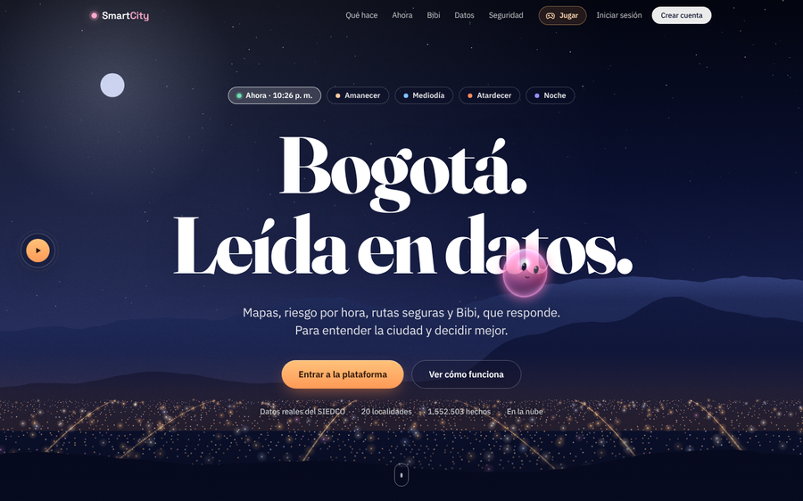
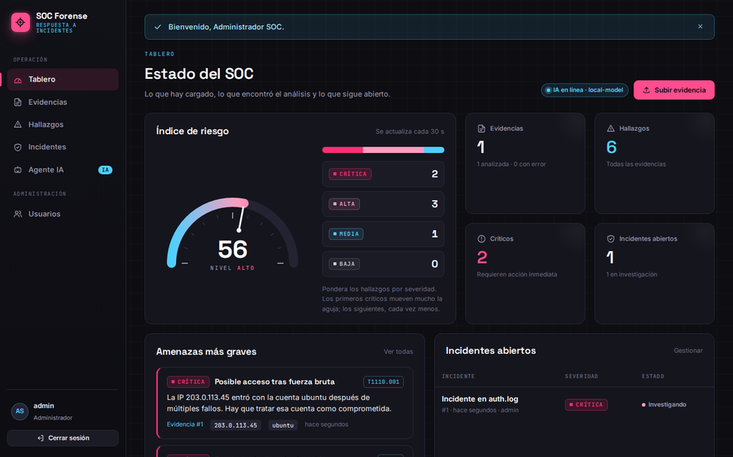

<!-- Header -->

  

  

  
  
  
  

---

### 🌸 About me

<table>
  <tr>
    <td width="50%" valign="top">

📍 **Based in** Bogotá, Colombia 
🎓 **Studying** Systems Engineering, 8th semester 
🏫 **University** Universidad de San Buenaventura 
🗣️ **Languages** Spanish (native), English (B1), French (A1)

  </td>
    <td width="50%" valign="top">

💼 **Background** 2+ years in 24/7 IT operations 
🎯 **Focus** AI agents, data, automation and security 
🌱 **Learning** RAG, automated testing and Spring Boot 
💬 **Open to** remote junior roles

  </td>
  </tr>
</table>

#### What I do
- 🤖 I build **AI agents** that answer with real data instead of guessing
- 📊 I process data at scale: **1.5M+ records** with Python ETL and MapReduce-style jobs
- 🔐 I care about security: password hashing, **two-factor auth**, role-based access, log analysis
- 🌙 I spent two years on the night shift keeping systems alive, so I build software that keeps working when nobody is watching
- 🎮 Fun fact: I also make games in **Unity**

---

### 🛠️ Tech I work with

  

  
  
  
  
  
  
  
  

---

### 🚀 Featured projects

<table>
  <tr>
    <td width="50%" valign="top">
      
      <h3>🏙️ SmartCity Bogotá</h3>
      
City data platform with an <b>AI agent</b> (LLM function calling + voice) that answers with real data. <b>1.5M+ crime records</b> processed for maps and Power BI. PBKDF2, TOTP 2FA and roles.

      

        
        
        
        
      

      🔒 Private repository, demo on request
    </td>
    <td width="50%" valign="top">
      
      <h3>🛡️ SOC Forense</h3>
      
Upload a security log, get the attacks, open the incident. <b>SHA-256</b> evidence sealing, a rule engine mapped to <b>MITRE ATT&amp;CK</b> and a <b>local LLM</b> that drafts response plans.

      

        
        
        
      

      <a href="https://github.com/ValenJV/soc-forense"><b>View repository →</b></a>
    </td>
  </tr>
  <tr>
    <td colspan="2" align="center">
      <h3>🎮 Shrine of the Gods</h3>
      
Adventure card game in <b>Unity + C#</b>: deck building, mana, turns and an AI opponent. Code coming soon

    </td>
  </tr>
</table>

---

### 📈 GitHub stats

  

  <picture>
    <source media="(prefers-color-scheme: dark)" srcset="https://raw.githubusercontent.com/ValenJV/ValenJV/output/github-snake-dark.svg"/>
    <source media="(prefers-color-scheme: light)" srcset="https://raw.githubusercontent.com/ValenJV/ValenJV/output/github-snake.svg"/>
    
  </picture>

---

### 🤝 Let's connect

  I'm open to <b>remote junior roles</b> in AI automation, data, backend and security operations. 
  The fastest way to reach me is by email or LinkedIn.

  
  
  

  

